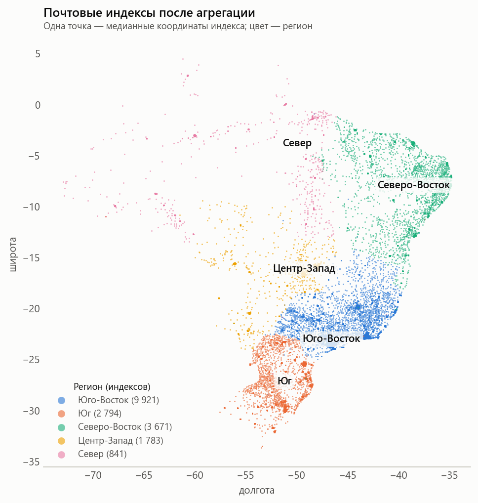
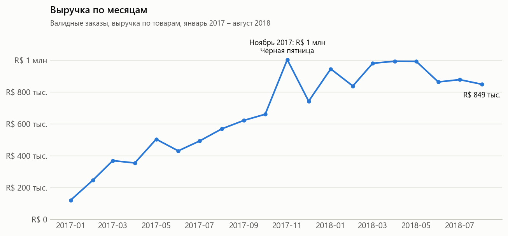
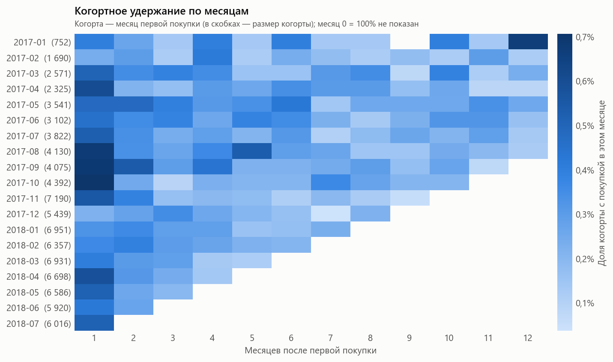
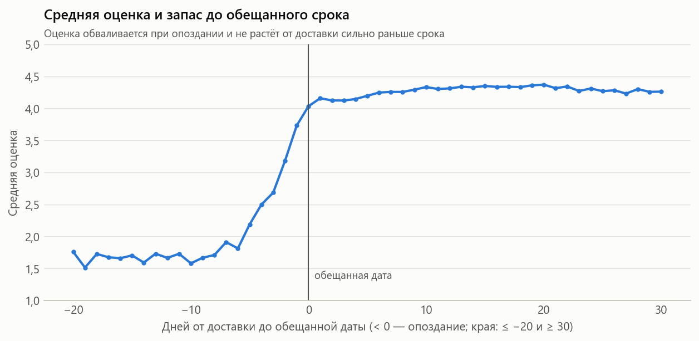
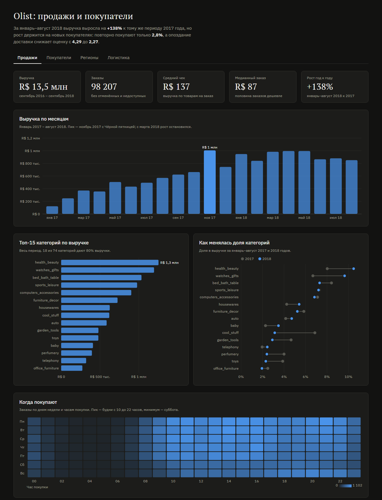

# Unified Retail Analytics Platform

Аналитический проект по данным электронной коммерции: продажи, покупатели, товары и поведение пользователей.
[Olist](https://www.kaggle.com/datasets/olistbr/brazilian-ecommerce) — публичный датасет бразильского маркетплейса:
около 100 тыс. заказов за 2016–2018 годы с товарами, платежами, отзывами и доставкой.

## Подготовка данных

Ноутбуки в [`notebooks/olist/pipeline/`](notebooks/olist/pipeline/) проходят по этапам конвейера и показывают,
что происходит с данными на каждом из них: проблемы источника, проверки, «до и после», формулы метрик качества.

| Ноутбук | Что внутри |
|---|---|
| [01_raw_exploration](notebooks/olist/pipeline/01_raw_exploration.ipynb) | состав таблиц, пропуски, ключи и дубликаты, связи и кардинальность, покупатель и заказ, временной охват, согласованность дат, распределения и выбросы (IQR), геолокация |
| [02_bronze](notebooks/olist/pipeline/02_bronze.ipynb) | полнота загрузки, многострочные записи, технические поля, сжатие CSV → Parquet, скорость чтения |
| [03_silver](notebooks/olist/pipeline/03_silver.ipynb) | отчёт о качестве, типы данных, ведущие нули, очистка городов, агрегация геолокации (карта регионов), флаги качества, последний отзыв, справочник категорий |
| [04_gold](notebooks/olist/pipeline/04_gold.ipynb) | схема «звезда», сверки сумм, размножение строк при неправильном соединении (+4,5% к выручке), разбитые чекауты, элементы `unknown`, согласованность витрин |



## Аналитика

Ноутбуки обращаются к слою Gold SQL-запросами через DuckDB (`src/analytics/db.py`, функция `q`)
и используют общий стиль графиков (`src/analytics/style.py`). Графики также сохраняются в `reports/figures/`.

| Ноутбук | Вопросы |
|---|---|
| [01_sales_analytics](notebooks/olist/01_sales_analytics.ipynb) | общая выручка, динамика по месяцам, топ категорий, средний чек, средний чек по категориям, сезонность, регионы |
| [02_customer_analytics](notebooks/olist/02_customer_analytics.ipynb) | доля повторных покупок, RFM-сегментация, когортное удержание, CLV, частота покупок, сегменты с наибольшей выручкой |
| [03_product_analytics](notebooks/olist/03_product_analytics.ipynb) | самые продаваемые товары, цена и продажи, изменение долей категорий, дорогие нишевые товары |
| [04_logistics_analytics](notebooks/olist/04_logistics_analytics.ipynb) | срок доставки и его этапы, доля опозданий, связь оценки и доставки |

Главные выводы:

**Продажи**

- R&#36; 13,5 млн выручки, 98 тыс. заказов; январь–август 2018 — +138% год к году, но с марта 2018 выручка не растёт.
- Средний чек R&#36; 137 при медиане R&#36; 87; рост шёл за счёт числа заказов, а не их размера.
- 18 из 74 категорий дают 80% выручки; watches_gifts сочетает высокий чек и большой объём.
- Юго-Восток даёт 65% выручки; в удалённых штатах выше средний чек и в 2–3 раза дороже доставка (r = 0,86).

**Покупатели**

- 97,2% покупателей купили один раз; доля повторных покупок 2,8%, они дают 5,2% выручки.
- Удержание когорт ~0,5% в первый месяц и 0,2–0,4% дальше; со временем не улучшается.
- CLV за год ≈ R&#36; 144 — всего на 4% больше первой покупки.
- Повторно чаще покупают после «домашних» категорий (fashion_bags_accessories 5,2%, bed_bath_table 4,1%),
  реже всего — после electronics и подарков (1,6–2,0%). Оценка первого заказа влияет слабо.
- Крупные разовые покупатели (Новые крупные + Спящие крупные) — 30% базы и 58% выручки.

**Товары**

- Длинный хвост: 55% товаров проданы один раз; топ-100 товаров дают лишь 13,5% выручки.
- Цена почти не связана с числом продаж (Спирмен −0,07), а верхний ценовой дециль даёт 33% выручки.
- health_beauty и watches_gifts выросли до ~10% выручки каждая; cool_stuff потеряла половину доли.
- 1 107 дорогих товаров (медиана R&#36; 860) при 1–3 заказах дают 12,9% выручки.

**Логистика**

- Срок доставки — 12,6 дня в среднем (медиана 10,2), почти весь срок — перевозка; к августу 2018 сократился до 7,7 дня.
- Опаздывают 6,8% заказов; пики — Чёрная пятница и февраль–март 2018 (до 19%).
- Опоздание — главный фактор оценки: 2,3 балла против 4,3 и 62% негативных отзывов.
  Доставка раньше обещанного срока оценку не повышает: покупатели оценивают выполнение обещания, а не скорость.







## Дашборд

Интерактивный дашборд в папке [`dashboard/`](dashboard/): четыре вкладки (продажи, покупатели, регионы, логистика),
графики на d3 с подсказками при наведении, сортируемая таблица штатов.



## Структура репозитория

```
data/              raw / bronze / silver / gold (не хранится в git)
notebooks/olist/   аналитические ноутбуки; pipeline/ — ноутбуки этапов подготовки данных
dashboard/         интерактивный дашборд
reports/figures/   графики из ноутбуков
src/
  analytics/       подключение к Gold (DuckDB) и стиль графиков
  utils/           конфигурация, Spark-сессия, проверки качества
  ingestion/       загрузка датасетов, слой Bronze
  exploration/     профилирование исходных данных
  transformations/ слои Silver и Gold
docs/
  architecture/    описание слоёв
  data_dictionary/ словарь данных
  data_models/     модели данных
```

