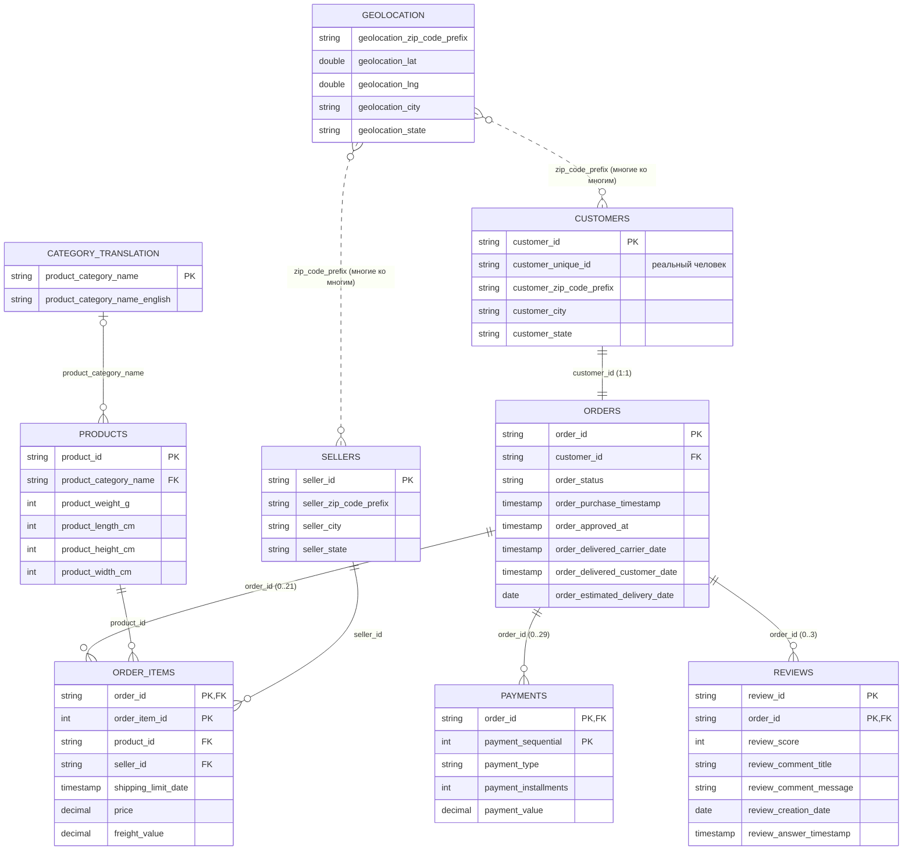

# Olist — ER-диаграмма источника

Связи между таблицами в исходных CSV, проверенные скриптом `src/exploration/profile_olist.py`.
Кардинальности — наблюдаемые значения, а не гарантии из документации.

## Ловушки размножения строк

Если в одном запросе соединить `orders` больше чем с одной из таблиц `order_items`, `payments`, `reviews`,
строки размножаются: заказ с 3 товарами и 2 платежами превращается в 6 строк, и `sum(price)` удваивается.
Поэтому в целевой модели у каждой гранулярности своя таблица фактов (`fact_order_items`, `fact_payments`,
`fact_reviews`, `fact_orders`), а связываются они только через уже агрегированные показатели заказа.

У `geolocation` нет ключа: перед любым соединением её нужно свести к одной строке на почтовый индекс.
