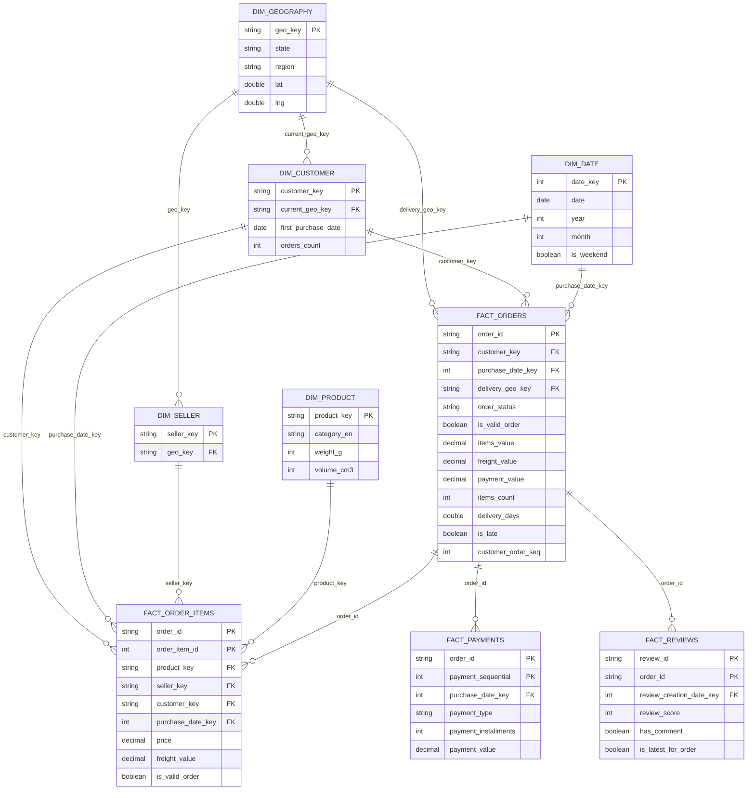

# Olist — целевая модель данных (схема «звезда»)

Модель построена по результатам анализа источника: [словарь данных](../data_dictionary/olist.md)
и [ER-диаграмма источника](olist_source_er.md).
Реализация — [gold_core.py](../../src/transformations/olist/gold_core.py); колонки, добавленные при реализации,
перечислены в [gold.md](../architecture/gold.md).

## Слои

| Слой | Содержимое | Формат | Расположение |
|---|---|---|---|
| Bronze | 9 исходных таблиц 1:1 с CSV + технические поля загрузки | Parquet | `data/bronze/olist/<таблица>/` |
| Silver | очищенные, типизированные, без дубликатов таблицы источника + флаги качества | Parquet | `data/silver/olist/<таблица>/` |
| Gold / core | схема «звезда»: измерения и факты ниже | Parquet | `data/gold/olist/core/<таблица>/` |
| Gold / marts | агрегированные витрины для аналитики | Parquet | `data/gold/olist/marts/<таблица>/` |

## Диаграмма

## Ключевые решения

| № | Решение | Причина |
|---|---|---|
| 1 | **Естественные ключи** (md5-хэши источника) в измерениях; `date_key` — целое `yyyyMMdd` | id источника уже стабильны и уникальны. Суррогатные ключи Spark (`monotonically_increasing_id`, `row_number`) меняются между запусками, и факты пришлось бы пересобирать при каждой перезагрузке измерения |
| 2 | `customer_key = customer_unique_id` | `customer_id` создаётся для каждого заказа (проблема №1 в словаре данных); человек — это `customer_unique_id`. `customer_id` остаётся в `fact_orders` для прослеживаемости |
| 3 | Адрес покупателя: **SCD тип 1** в `dim_customer` (последний адрес) + `delivery_geo_key` в `fact_orders` (адрес на момент заказа) | 250 покупателей меняли индекс между заказами. Продажи по регионам считаются по адресу заказа, профиль покупателя — по последнему адресу |
| 4 | Четыре таблицы фактов с разной гранулярностью, связаны только через `order_id` | соединение товаров, платежей и отзывов в одном запросе размножает строки. `fact_orders` хранит уже агрегированные показатели заказа, поэтому большинству вопросов хватает одной таблицы фактов |
| 5 | `dim_geography` — одна строка на почтовый индекс | в геолокации ~53 строки на индекс (проблема №4). Координаты — медиана после удаления точек за пределами Бразилии; город и штат — самое частое значение |
| 6 | Элементы «неизвестно» | `geo_key = 'unknown'` для индексов, которых нет в геолокации (~0,3%); категория `unknown` для 610 товаров. Внешние ключи в фактах никогда не пустые, поэтому внутренние соединения не теряют строки |
| 7 | Валидность — флаг, а не фильтр | отменённые и недоступные заказы сохраняются с `is_valid_order = false`. Анализ отмен остаётся возможным, а правило выручки задано в одном месте |
| 8 | Количество = число строк | в источнике нет колонки количества: один товар в заказе повторяется несколькими строками `order_item_id` (6 968 заказов) |
| 9 | Покупка ≠ заказ | у 582 заказов совпадают покупатель и секунда покупки: это один чекаут, разбитый по продавцам. Повторные покупки считаются по уникальным `(customer_key, purchase_timestamp)`, а не по заказам |

## Измерения

### dim_date

Гранулярность: один календарный день, 2016-09-01 … 2018-12-31 (охватывает и обещанные даты доставки).

| Колонка | Тип | Описание |
|---|---|---|
| date_key | целое | `yyyyMMdd`, первичный ключ |
| date | дата | |
| year, quarter, month, day | целое | год, квартал, месяц, день |
| month_name | строка | название месяца |
| year_month | строка | `yyyy-MM`, используется для когорт |
| iso_week, day_of_week | целое | неделя ISO; день недели: 1 = понедельник |
| is_weekend | логический | выходной |
| is_in_analysis_window | логический | 2017-01-01 … 2018-08-31 |

### dim_customer

Гранулярность: один человек (`customer_unique_id`), 96 096 строк.

| Колонка | Тип | Описание |
|---|---|---|
| customer_key | строка | `customer_unique_id`, первичный ключ |
| current_zip_code_prefix | строка | индекс последнего заказа |
| current_geo_key | строка | ссылка на dim_geography |
| first_purchase_date | дата | первый валидный заказ |
| last_purchase_date | дата | последний валидный заказ |
| cohort_month | строка | `yyyy-MM` первого валидного заказа |
| orders_count | целое | валидные заказы |
| purchase_occasions_count | целое | уникальные моменты покупки среди валидных заказов |

### dim_product

Гранулярность: один товар, 32 951 строка.

| Колонка | Тип | Описание |
|---|---|---|
| product_key | строка | `product_id`, первичный ключ |
| category_pt | строка | `unknown`, если категории нет |
| category_en | строка | из таблицы перевода; 2 недостающих перевода добавлены вручную |
| name_length, description_length, photos_qty | целое | опечатка источника `lenght` исправлена |
| weight_g, length_cm, height_cm, width_cm | целое | вес и габариты |
| volume_cm3 | целое | длина × высота × ширина |

### dim_seller

Гранулярность: один продавец, 3 095 строк.

| Колонка | Тип | Описание |
|---|---|---|
| seller_key | строка | `seller_id`, первичный ключ |
| zip_code_prefix | строка | почтовый индекс |
| geo_key | строка | ссылка на dim_geography |

### dim_geography

Гранулярность: один почтовый индекс (~19 000 строк + `unknown`).

| Колонка | Тип | Описание |
|---|---|---|
| geo_key | строка | почтовый индекс, первичный ключ |
| city | строка | самое частое написание |
| state | строка | двухбуквенный код штата |
| region | строка | Norte, Nordeste, Centro-Oeste, Sudeste, Sul |
| lat, lng | дробное | медиана точек внутри Бразилии |

Штаты по регионам:
Norte (Север): AC, AM, AP, PA, RO, RR, TO · Nordeste (Северо-Восток): AL, BA, CE, MA, PB, PE, PI, RN, SE ·
Centro-Oeste (Центр-Запад): DF, GO, MS, MT · Sudeste (Юго-Восток): ES, MG, RJ, SP · Sul (Юг): PR, RS, SC.

## Факты

### fact_orders

Гранулярность: один заказ, 99 441 строка.

| Колонка | Тип | Описание |
|---|---|---|
| order_id | строка | первичный ключ |
| customer_id | строка | id покупателя заказа из источника (для прослеживаемости) |
| customer_key | строка | ссылка на dim_customer |
| delivery_geo_key | строка | ссылка на dim_geography, адрес этого заказа |
| purchase_date_key | целое | ссылка на dim_date |
| order_status | строка | статус заказа |
| purchase_ts, approved_ts, delivered_carrier_ts, delivered_customer_ts | дата и время | покупка, подтверждение оплаты, передача перевозчику, доставка |
| estimated_delivery_date | дата | обещанная дата доставки |
| is_valid_order | логический | статус не canceled и не unavailable |
| items_count | целое | число строк в order_items |
| distinct_products, distinct_sellers | целое | разных товаров и продавцов |
| items_value | десятичное | sum(price) |
| freight_value | десятичное | sum(freight_value) |
| payment_value | десятичное | sum(payment_value) |
| payments_count | целое | число платежей |
| main_payment_type | строка | способ оплаты с наибольшей суммой |
| max_installments | целое | максимальное число платежей рассрочки |
| review_score | целое | последний отзыв, пусто, если отзыва нет |
| delivery_days | дробное | доставка − покупка; пусто, если не доставлен или даты противоречивы |
| is_late | логический | дата доставки позже обещанной |
| customer_order_seq | целое | 1 = первый валидный заказ покупателя |
| has_items, has_payment, has_review | логический | есть товары, платёж, отзыв |
| is_timestamp_inconsistent | логический | проблема №8 в словаре данных |

### fact_order_items

Гранулярность: одна товарная позиция (`order_id`, `order_item_id`), 112 650 строк.

| Колонка | Тип | Описание |
|---|---|---|
| order_id, order_item_id | строка, целое | первичный ключ |
| product_key | строка | ссылка на dim_product |
| seller_key | строка | ссылка на dim_seller |
| customer_key | строка | ссылка на dim_customer (скопировано из заказа) |
| purchase_date_key | целое | ссылка на dim_date (скопировано из заказа) |
| delivery_geo_key | строка | ссылка на dim_geography (скопировано из заказа) |
| shipping_limit_ts | дата и время | крайний срок передачи перевозчику |
| price, freight_value | десятичное | цена и доставка позиции |
| is_valid_order | логический | скопировано из заказа |
| is_shipping_limit_outlier | логический | проблема №10 в словаре данных |

Атрибуты заказа скопированы сюда, чтобы анализ по категориям и продавцам не требовал соединения с `fact_orders`.

### fact_payments

Гранулярность: один платёж (`order_id`, `payment_sequential`), 103 886 строк.
Колонки: `order_id`, `payment_sequential`, `customer_key`, `purchase_date_key`, `payment_type`,
`payment_installments`, `payment_value`, `is_valid_order`.

### fact_reviews

Гранулярность: одна связь «отзыв ↔ заказ» (`review_id`, `order_id`), 99 224 строки.
Колонки: `review_id`, `order_id`, `customer_key`, `review_creation_date_key`, `review_score`,
`has_title`, `has_comment`, `answer_hours`, `is_latest_for_order`.

## Витрины Gold и их источники

| Витрина | Гранулярность | Строится из |
|---|---|---|
| gold_sales_daily | день | fact_orders |
| gold_sales_category | месяц × категория | fact_order_items + dim_product |
| gold_customer_metrics | покупатель | fact_orders + dim_customer |
| gold_product_metrics | товар | fact_order_items + fact_orders (отзыв) |
| gold_payment_metrics | месяц × способ оплаты | fact_payments |
| gold_logistics_metrics | месяц × штат покупателя | fact_orders + dim_geography |
| gold_rfm_segments | покупатель | fact_orders |

## Правила проверки (выполняются при сборке Silver и Gold)

| Проверка | Ожидание |
|---|---|
| уникальность первичного ключа в каждой таблице | 0 дубликатов |
| каждый внешний ключ фактов находит запись в измерении | 0 «висячих» ссылок (с учётом `unknown`) |
| `count(fact_orders)` | = `count(silver.orders)` |
| `count(fact_order_items)` | = `count(silver.order_items)` |
| `sum(fact_order_items.price)` | = `sum(fact_orders.items_value)` |
| `sum(fact_payments.payment_value)` | = `sum(fact_orders.payment_value)` |
| `fact_reviews` с `is_latest_for_order` | ровно одна строка на заказ с отзывом |
| `count(dim_customer)` | = число уникальных `customer_unique_id` |
